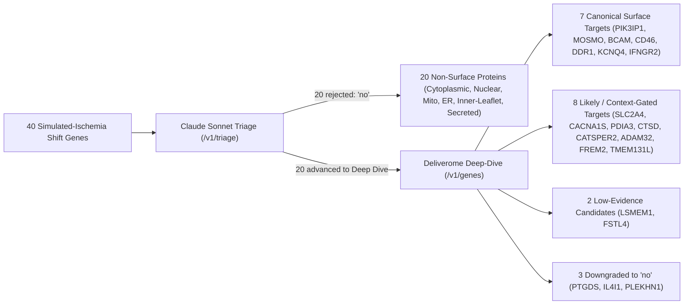

# Simulated Ischemia Top-40 Surfaceome Deep-Dive & LLM Triage Report


> [!IMPORTANT]
> **Half of the 40 genes in the ischemia heatmap are false-positive surface annotations (`20/40` rejected at LLM triage, plus `3/20` deep-dived genes graded `no`).**
> Upstream pathway/ligand-receptor databases frequently misclassify intracellular kinases (`CAMK2B`, `STK40`, `ATR`), ER/mitochondrial sensors (`ERN1`/IRE1$\alpha$, `BCL2L1`, `NT5M`, `PLEKHN1`), nuclear factors (`SIRT7`, `RBMX`, `PRMT5`), cytosolic enzymes (`EGLN1`/PHD2, `ACACA`, `CALM2`, `PSMD2`, `NEB`, `TNFAIP2`), inner-leaflet proteins (`THEM4`), and soluble hormones/enzymes (`NPPB`/BNP, `PTGDS`, `IL4I1`, `TGM4`) as `"receptor"`, `"plasma_membrane"`, or `"ecm"`. Deliverome's Claude Sonnet triage + deep-dive pipeline isolates the **15 true/likely cell-surface targets** (`7 canonical`, `8 likely`) and **2 low-evidence candidates** (`LSMEM1`, `FSTL4`).



---

## 1. Validated & Likely Cell-Surface Targets (`canonical` and `likely` tiers — 15 genes)

These 15 genes pass both LLM triage and per-gene deep-dive validation (`SurfaceomeRecord` v2.14). Notice that several top ischemia-shift genes (`SLC2A4`/GLUT4, `PDIA3`/ERp57, `CTSD`, `PIK3IP1`, `CACNA1S`, `KCNQ4`) have direct cardiovascular, skeletal/vascular muscle, or stress/ischemia-regulated surface biology:

| Symbol (Plot Input) | Plot Label | DB Votes | Triage | Deep-Dive Tier | Access. | Call Reason | State Dep. | Topology (TM / ECD aa) | Mouse ECD %ID | Intern. | Bind / Tag Sites | Headline Risks |
|---|---|---:|---|---|---|---|---|---|---:|---|---|---|
| **PIK3IP1** (`Pik3ip1`) | `cell_surface` | 2/5 | `yes` | **canonical** | `high` | `cell_state_induced` | `high` | 1 TM / 151 aa | 76.3% | `moderate` | 1 / 11 | `shed_form`, `epitope_masked` |
| **SLC2A4** (`Slc2a4`) | `receptor` | 4/5 | `contextual` | **likely** | `high` | `cell_state_induced` | `high` | 12 TM / 71 aa | 85.1% | `moderate` | 0 / 4 | `epitope_masked` |
| **CACNA1S** (`Cacna1s`) | `receptor` | 2/5 | `yes` | **likely** | `high` | `tissue_restricted_surface` | `moderate` | 24 TM / 461 aa | 94.1% | `moderate` | 0 / 0 | `epitope_masked` |
| **MOSMO** (`Mosmo`) | `cell_surface` | 3/5 | `yes` | **canonical** | `moderate` | `dual_localization` | `moderate` | 4 TM / 64 aa | 100.0% | `moderate` | 0 / 2 | `epitope_masked` |
| **PDIA3** (`Pdia3`) | `receptor` | 1/5 | `contextual` | **likely** | `high` | `cell_state_induced` | `high` | 0 TM / 481 aa | 93.8% | `low` | 0 / 0 | `secreted_form`, `epitope_masked` |
| **BCAM** (`Bcam`) | `receptor` | 4/5 | `yes` | **canonical** | `high` | `classical_surface_receptor` | `moderate` | 1 TM / 520 aa | 72.7% | `moderate` | 2 / 9 | `shed_form`, `secreted_form` |
| **CTSD** (`Ctsd`) | `receptor` | 1/5 | `contextual` | **likely** | `moderate` | `cell_state_induced` | `high` | 0 TM / 392 aa | 83.7% | `very_low` | 0 / 0 | `secreted_form` |
| **CD46** (`Cd46`) | `receptor` | 5/5 | `yes` | **canonical** | `high` | `classical_surface_receptor` | `moderate` | 1 TM / 311 aa | — | `moderate` | 3 / 6 | `shed_form`, `secreted_form` |
| **CATSPER2** (`Catsper2`) | `receptor` | 2/5 | `contextual` | **likely** | `high` | `tissue_restricted_surface` | `high` | 6 TM / 75 aa | 70.9% | `moderate` | 0 / 0 | `co_receptor`, `epitope_masked` |
| **ADAM32** (`Adam32`) | `receptor` | 2/5 | `contextual` | **likely** | `moderate` | `tissue_restricted_surface` | `high` | 1 TM / 666 aa | 60.9% | `moderate` | 3 / 32 | none |
| **DDR1** (`Ddr1`) | `receptor` | 3/5 | `yes` | **canonical** | `high` | `classical_surface_receptor` | `moderate` | 1 TM / 397 aa | 92.7% | `high` | 3 / 18 | `shed_form` |
| **FREM2** (`Frem2`) | `cell_surface` | 3/5 | `no` | **likely** | `moderate` | `cell_state_induced` | `high` | 1 TM / 3064 aa | 89.1% | `low` | 6 / 41 | `shed_form`, `epitope_masked` |
| **KCNQ4** (`Kcnq4`) | `receptor` | 2/5 | `yes` | **canonical** | `high` | `multipass_with_exposed_loops` | `moderate` | 6 TM / 56 aa | 100.0% | `moderate` | 0 / 3 | `epitope_masked` |
| **IFNGR2** (`Ifngr2`) | `receptor` | 2/5 | `yes` | **canonical** | `high` | `classical_surface_receptor` | `moderate` | 1 TM / 227 aa | 55.1% | `moderate` | 3 / 7 | `epitope_masked` |
| **TMEM131L** (`Tmem131l`) | `cell_surface` | 3/5 | `contextual` | **likely** | `moderate` | `tissue_restricted_surface` | `high` | 1 TM / 834 aa | 82.9% | `moderate` | 5 / 25 | none |

### Per-Gene Deep-Dive Dossiers (Top Ischemia-Relevant & Canonical Receptors)

- **PIK3IP1 (`Pik3ip1`, `canonical`, high accessibility, Bin 4 terminal up-shift):**
  - *Topology & Conservation:* Single-pass Type I TM protein (`Q96FE7`), 151 aa kringle-containing ECD, 72 aa cytoplasmic PI3K-inhibitory tail. Mouse ECD identity: **76.3%** (cyno: **94.0%**). 1 SURFACE-Bind site, 11 tag sites, `moderate` internalization.
  - *Biology & Risks:* Constitutively surface-accessible on resting T cells and expressed in cardiac/hepatic tissues; undergoes rapid ADAM-protease ectodomain shedding upon activation (`shed_form` moderate risk; `epitope_masked` via ECD oligomerization).

- **SLC2A4 / GLUT4 (`Slc2a4`, `likely`, high accessibility, state-gated translocation):**
  - *Topology & Conservation:* 12-TM glucose transporter (`P14672`), 71 aa total exposed ECD loops (mean pLDDT 87.0). Mouse ECD identity: **85.1%** (FL: **95.3%**, cyno ECD: **100%**). 4 tag sites, `moderate` internalization.
  - *Biology & Risks:* Classic ischemia- and insulin-translocated transporter in cardiomyocytes, skeletal muscle, and adipocytes. Sequestered in intracellular GLUT4 storage vesicles (GSVs) at baseline, but acute ischemia/hypoxia, contraction, or insulin drives rapid sarcolemmal translocation. Main caveat is N57 glycan-mediated `epitope_masked` on the large exofacial loop; no shed/secreted decoy pool.

- **BCAM (`Bcam`, `canonical`, high accessibility, early Bin 0 high -> ischemia down-shift):**
  - *Topology & Conservation:* Single-pass Type I TM receptor (`P50895`) with 5 Ig-like domains (520 aa ECD, pLDDT 90.4). Mouse ECD identity: **72.7%** (cyno: **96.5%**). 2 SURFACE-Bind sites, 9 tag sites, `moderate` internalization.
  - *Biology & Risks:* Constitutively expressed on endothelial, epithelial, and erythroid cells (laminin $\alpha$5 receptor). Exhibits ADAM10/MMP-mediated shedding (`shed_form`) releasing soluble sBCAM.

- **CD46 (`Cd46`, `canonical`, high accessibility, 5/5 DB consensus):**
  - *Topology & Conservation:* Single-pass Type I complement regulatory receptor (`P15529`, 311 aa ECD, pLDDT 87.1). Cyno ECD identity: **84.2%** (rodents lack a 1:1 somatic CD46 surface ortholog, restricting mouse CD46 expression to spermatozoa/testis via *Crry* functional divergence). 3 SURFACE-Bind sites, 6 tag sites, `moderate` internalization.
  - *Biology & Risks:* Pan-nucleated human cell surface complement regulator; MMP-mediated ectodomain shedding (`shed_form`) is documented in acute coronary syndrome (ACS) and inflammation.

- **DDR1 (`Ddr1`, `canonical`, high accessibility, Bin 4 terminal strong up-shift):**
  - *Topology & Conservation:* Single-pass Type I collagen receptor tyrosine kinase (`Q08345`, 397 aa ECD, pLDDT 85.5). Mouse ECD identity: **92.7%** (cyno: **99.5%**). 3 SURFACE-Bind sites, 18 tag sites, **`high` internalization**.
  - *Biology & Risks:* Pan-epithelial and vascular smooth muscle collagen sensor; strong internalization grade (`high`) makes it well-suited for internalizing payloads, though constitutive MT1-MMP cleavage (`shed_form`) produces soluble sDDR1 ectodomain.

- **IFNGR2 (`Ifngr2`, `canonical`, high accessibility, Bin 4 terminal up-shift):**
  - *Topology & Conservation:* Single-pass Type I cytokine receptor chain (`P38484`, 227 aa ECD, pLDDT 92.9). Mouse ECD identity: **55.1%** (cyno: **94.7%** — note low mouse-human cross-reactivity). 3 SURFACE-Bind sites, 7 tag sites, `moderate` internalization.
  - *Biology & Risks:* Constitutively surface-accessible across endothelial, epithelial, and myeloid cells; upregulated on M1 macrophages and during inflammatory stress, with rapid LI-motif endocytosis.

- **KCNQ4 (`Kcnq4`, `canonical`, high accessibility) & CACNA1S (`Cacna1s`, `likely`, high accessibility):**
  - *Topology & Conservation:* Multi-pass ion channels (`KCNQ4`: 6 TM, 56 aa ECD, **100%** mouse ECD identity; `CACNA1S`: 24 TM, 461 aa ECD, **94.1%** mouse ECD identity).
  - *Biology & Risks:* `KCNQ4` is surface-accessible on vascular smooth muscle cells (regulating vascular tone) and cochlear hair cells, though in cardiomyocytes it localizes to mitochondria. `CACNA1S` (Cav1.1) is restricted to skeletal muscle T-tubule/sarcolemmal membranes. Both have compact extracellular loops with `epitope_masked` caveats.

- **PDIA3 / ERp57 (`Pdia3`, `likely`, high stress-induced accessibility) & CTSD (`Ctsd`, `likely`, moderate stress-induced accessibility):**
  - *Topology & Conservation:* Non-TM luminal proteins (`PDIA3`: 481 aa, **93.8%** mouse identity; `CTSD`: 392 aa, **83.7%** mouse identity) that translocate to the outer plasma membrane during cellular stress, immunogenic cell death, platelet activation (`PDIA3`), or lysosomal exocytosis / M6P-receptor retention (`CTSD`).
  - *Biology & Risks:* Relevant to late-bin ischemic stress (`PDIA3` peaks in Bin 4), but both carry `secreted_form` decoy risk and `low`/`very_low` internalization.

- **MOSMO (`Mosmo`, `canonical`, 4 TM, 100% mouse ECD identity), FREM2 (`Frem2`, `likely`, 1 TM / 3064 aa ECD, 89.1% mouse ECD identity), TMEM131L (`Tmem131l`, `likely`, 1 TM / 834 aa ECD, 82.9% mouse ECD identity), CATSPER2 (`Catsper2`, sperm-restricted), ADAM32 (`Adam32`, sperm-restricted):**
  - `MOSMO` is a 4-TM plasma-membrane/ciliary Hedgehog modulator (complexed with MEGF8). `CATSPER2` and `ADAM32` are strictly testis/spermatozoa-restricted in normal physiology.

---

## 2. Deep-Dived Candidates Graded `low` or `no` (5 genes)

Five genes from the plot entered the Deliverome deep-dive pipeline because of borderline triage calls (`contextual`) or 1 DB vote, but the literature ledger downgraded them to `low` (no protein-level surface validation yet) or `no` (soluble secreted or mitochondrial):

| Symbol (Plot Input) | Plot Label | DB Votes | Triage Call | Deep-Dive Tier | Access. | Call Reason | Deep-Dive Verdict & Rationale |
|---|---|---:|---|---|---|---|---|
| **LSMEM1** (`Lsmem1`) | `cell_surface` | 1/5 | `contextual` (`dual_localization`) | **low** | `low` | `cell_state_induced` | 1-TM predicted topology (48 aa ECD, 85.4% mouse ECD identity), upregulated in CKD kidney tubules, but **zero direct experimental plasma-membrane readouts** exist in literature. |
| **FSTL4** (`Fstl4`) | `ecm` | 0/5 | `contextual` (`lysosomal_exocytosis`) | **low** | `low` | `cell_state_induced` | 0-TM follistatin-like protein (820 aa); only RNA-level upregulation in lung adenocarcinoma is reported, with no direct surface protein evidence. |
| **PTGDS** (`Ptgds`) | `receptor` | 0/5 | `contextual` (`stable_surface_attachment`) | **no** | `no` | `secreted_only` | L-PGDS (prostaglandin D2 synthase) is a **freely secreted lipocalin** (0 TM; 2nd most abundant protein in CSF) whose *product* ($\text{PGD}_2$) binds receptors, not PTGDS itself. |
| **IL4I1** (`Il4i1`) | `ecm` | 1/5 | `contextual` (`dual_localization`) | **no** | `no` | `secreted_only` | Secreted L-amino-acid oxidase (0 TM) released into the synaptic cleft and extracellular space with no stable membrane anchor. |
| **PLEKHN1** (`Plekhn1`) | `plasma_membrane` | 1/5 | `contextual` (`dual_localization`) | **no** | `no` | `mitochondrial_internal` | N-myristoylated PH-domain protein anchored to the **cytoplasmic face of the mitochondrial outer membrane** and nucleus (0 TM, 0 aa ECD); SIM imaging explicitly refutes plasma-membrane presence. |

---

## 3. Triage-Rejected Candidates (`20/40` Genes Filtered Out by Claude Sonnet)

These 20 genes were labeled `receptor`, `plasma_membrane`, `ecm`, or `ligand` in the source plot, but Deliverome's Claude Sonnet triage (`claude-sonnet-4-6`) rejected all 20 as non-surface (`verdict: "no"`):

| Symbol (Plot Input) | Plot Label | DB Votes | Claude Verdict | Triage Reason | Mechanistic Summary from `/v1/triage/{SYMBOL}` |
|---|---|---:|---|---|---|
| **THEM4** (`Them4`) | `plasma_membrane` | 0/5 | `no` | `inner_leaflet_anchored` | Thioesterase (CTMP) bound to the **cytoplasmic inner leaflet** of the PM and mitochondria where it regulates Akt; no TM domain or ectodomain. |
| **CALM2** (`Calm2`) | `plasma_membrane` | 0/5 | `no` | `cytoplasmic` | Calmodulin-2: soluble intracellular $\text{Ca}^{2+}$ sensor in the cytoplasm; binds cytoplasmic tails of channels but never crosses the bilayer. |
| **RBMX** (`Rbmx`) | `ecm` | 0/5 | `no` | `nuclear` | Heterogeneous nuclear ribonucleoprotein G (hnRNP-G); strictly nuclear pre-mRNA splicing factor. |
| **NT5M** (`Nt5m`) | `receptor` | 0/5 | `no` | `mitochondrial_internal` | Mitochondrial matrix $5',3'$-nucleotidase; resides inside the mitochondrial matrix. |
| **ERN1** (`Ern1`) | `receptor` | 0/5 | `no` | `endomembrane_resident` | IRE1$\alpha$: canonical **ER-resident** unfolded-protein-response transmembrane sensor; luminal domain is inside the ER lumen, not the plasma membrane. |
| **CAMK2B** (`Camk2b`) | `receptor` | 0/5 | `no` | `cytoplasmic` | Cytosolic/synaptic $\text{Ca}^{2+}$/calmodulin-dependent serine/threonine kinase II $\beta$. |
| **PSMD2** (`Psmd2`) | `ecm` | 0/5 | `no` | `cytoplasmic` | 26S proteasome non-ATPase regulatory subunit 2 (Rpn1); cytosolic/nuclear proteasome lid scaffold. |
| **SIRT7** (`Sirt7`) | `receptor` | 0/5 | `no` | `nuclear` | Nucleolar/chromatin $\text{NAD}^+$-dependent deacylase (class IV sirtuin). |
| **NEB** (`Neb`) | `ecm` | 0/5 | `no` | `cytoplasmic` | Nebulin: giant (~800 kDa) intrasarcomeric actin-binding scaffold inside skeletal muscle cytoplasm. |
| **ACACA** (`Acaca`) | `receptor` | 0/5 | `no` | `cytoplasmic` | Acetyl-CoA carboxylase 1 (ACC1): cytosolic rate-limiting enzyme in fatty acid synthesis. |
| **TGM4** (`Tgm4`) | `ecm` | 0/5 | `no` | `secreted_only` | Prostate transglutaminase: soluble secreted luminal enzyme with no TM or GPI anchor. |
| **BCL2L1** (`Bcl2l1`) | `receptor` | 0/5 | `no` | `cytoplasmic` | Bcl-xL: outer mitochondrial and ER membrane anti-apoptotic protein facing the cytosol. |
| **EGLN1** (`Egln1`) | `receptor` | 0/5 | `no` | `cytoplasmic` | PHD2 (prolyl hydroxylase domain-containing protein 2): cytosolic oxygen sensor that hydroxylates HIF-$\alpha$ (tagged `"receptor"` only because it is an intracellular oxygen sensor). |
| **PRMT5** (`Prmt5`) | `receptor` | 0/5 | `no` | `cytoplasmic` | Cytoplasmic/nuclear protein arginine methyltransferase 5. |
| **OSBPL2** (`Osbpl2`) | `plasma_membrane` | 1/5 | `no` | `endomembrane_resident` | Oxysterol-binding protein-related protein 2 (ORP2): cytosolic/Golgi/ER-membrane-contact-site lipid transfer protein facing the cytoplasm. |
| **TNFAIP2** (`Tnfaip2`) | `ecm` | 0/5 | `no` | `cytoplasmic` | Intracellular exocyst-associated protein (EXOC3L3) localized to cytosol and tunneling nanotubes. |
| **STK40** (`Stk40`) | `receptor` | 0/5 | `no` | `cytoplasmic` | Cytosolic/nuclear Tribbles-family pseudokinase. |
| **ATR** (`Atr`) | `receptor` | 0/5 | `no` | `nuclear` | Nuclear DNA-damage sensor kinase (ataxia telangiectasia and Rad3-related). |
| **TXLNA** (`Txlna`) | `ligand` | 0/5 | `no` | `cytoplasmic` | $\alpha$-Taxilin: cytoplasmic syntaxin-binding vesicle traffic regulator (formerly misnamed IL-14). |
| **NPPB** (`Nppb`) | `ligand` | 0/5 | `no` | `secreted_only` | Brain Natriuretic Peptide (BNP): soluble circulating cardiac hormone cleaved and secreted into plasma. |

---

## 4. Claude Sonnet / Opus Triage & SurfaceBench Evaluation Framework

We added two new modules to `surfaceome_mining` so you can both inspect Deliverome's benchmark/triage data and run your own Claude Sonnet/Opus triage passes:

- [deliverome.py](file:///Users/mightenyip/Documents/GitHub/surfaceomeMining/src/surfaceome_mining/sources/deliverome.py): Added `benchmark()`, `benchmark_gene()`, `benchmark_matrix()`, `triage()`, `triage_cell()`, `genes_index()`, automatic uppercase HGNC normalization (`Pik3ip1` $\rightarrow$ `PIK3IP1`), and disk caching for all per-gene routes.
- [deep_dive.py](file:///Users/mightenyip/Documents/GitHub/surfaceomeMining/src/surfaceome_mining/deep_dive.py): Added [`DeepDiveProfile`](file:///Users/mightenyip/Documents/GitHub/surfaceomeMining/src/surfaceome_mining/deep_dive.py#L31-L86), [`summarize_gene_bundle`](file:///Users/mightenyip/Documents/GitHub/surfaceomeMining/src/surfaceome_mining/deep_dive.py#L89-L214), [`deep_dive_genes`](file:///Users/mightenyip/Documents/GitHub/surfaceomeMining/src/surfaceome_mining/deep_dive.py#L217-L254), and [`format_deep_dive_markdown`](file:///Users/mightenyip/Documents/GitHub/surfaceomeMining/src/surfaceome_mining/deep_dive.py#L266-L335).
- [triage.py](file:///Users/mightenyip/Documents/GitHub/surfaceomeMining/src/surfaceome_mining/triage.py): Added the full SurfaceBench taxonomy (`yes` / `contextual` / `no` and all 19 canonical reasons), replicate majority aggregation ([`compute_majority`](file:///Users/mightenyip/Documents/GitHub/surfaceomeMining/src/surfaceome_mining/triage.py#L170-L217)), SurfaceBench scoring ([`score_benchmark_matrix`](file:///Users/mightenyip/Documents/GitHub/surfaceomeMining/src/surfaceome_mining/triage.py#L220-L280) and [`evaluate_predictions_against_benchmark`](file:///Users/mightenyip/Documents/GitHub/surfaceomeMining/src/surfaceome_mining/triage.py#L283-L334)), prompt construction ([`build_triage_prompt`](file:///Users/mightenyip/Documents/GitHub/surfaceomeMining/src/surfaceome_mining/triage.py#L337-L382)), and [`ClaudeTriageRunner`](file:///Users/mightenyip/Documents/GitHub/surfaceomeMining/src/surfaceome_mining/triage.py#L385-L493).

### SurfaceBench 147-Gene Accuracy Across Claude Models (`/v1/benchmark/matrix`)

| Model | Prompt Variant | Evaluated | Correct (`yes ≡ contextual`) | Refused | Accuracy | False Positives | False Negatives |
|---|---|---:|---:|---:|---:|---|---|
| `claude-sonnet-5-5` | `ncbi` | 147 | 145 | 0 | **98.6%** | ITPR3 | SRC |
| `claude-opus-4-8` | `ncbi` | 147 | 144 | 0 | **98.0%** | IZUMO4 | SRC, TMED10 |
| `claude-sonnet-4-6` | `ncbi` | 147 | 144 | 0 | **98.0%** | — | KLK2, SRC, TGOLN2 |
| `claude-sonnet-4-6` | `web_ncbi` | 147 | 143 | 0 | **97.3%** | ATG9A | ATP5F1B, C3, SRC |
| `claude-sonnet-4-6` | `pubmed_ncbi` | 147 | 143 | 0 | **97.3%** | ABCB9, ATG9A, PRAME | TGOLN2 |
| `claude-sonnet-5-5` | `naive` | 147 | 143 | 0 | **97.3%** | ATG9A, ITPR3, IZUMO4 | SRC |
| `claude-opus-5-5` | `ncbi_effort_low` | 145 | 141 | 2 | **97.2%** | ABCB9, ATG9A | FN1, SRC |
| `claude-opus-4-8` | `naive` | 147 | 142 | 0 | **96.6%** | ABCB9, IZUMO4 | ATP5F1B, KLK2, SRC |
| `claude-sonnet-4-6` | `naive` | 147 | 141 | 0 | **95.9%** | F2 | B4GALT1, SRC, TGOLN2, TMED10, VDAC1 |
| `claude-haiku-5-5` | `ncbi` | 147 | 141 | 0 | **95.9%** | ABCB9, ATG9A, IZUMO4 | KLK2, SRC, STIM1 |

### CLI & Python Usage Examples

```bash
# 1. Generate a deep-dive markdown or JSON report for any gene list
surfaceome-mine deep-dive \
  --symbols "Pik3ip1 (cell_surface),Slc2a4 (receptor),Cacna1s (receptor),Them4 (plasma_membrane)" \
  --cache-dir .scratch

# 2. View the SurfaceBench leaderboard across Claude models and prompt variants
surfaceome-mine benchmark --cache-dir .scratch

# 3. Inspect Deliverome's recorded Claude triage runs & reasoning for specific genes
surfaceome-mine triage PIK3IP1 SLC2A4 THEM4 --cache-dir .scratch

# 4. Run live Claude Sonnet / Opus triage (with 3-replicate majority voting & optional disease context)
ANTHROPIC_API_KEY="sk-ant-..." surfaceome-mine triage SLC2A4 PDIA3 THEM4 \
  --run-llm \
  --model claude-sonnet-4-6 \
  --variant ncbi \
  --replicates 3 \
  --context "simulated myocardial/skeletal ischemia"
```
